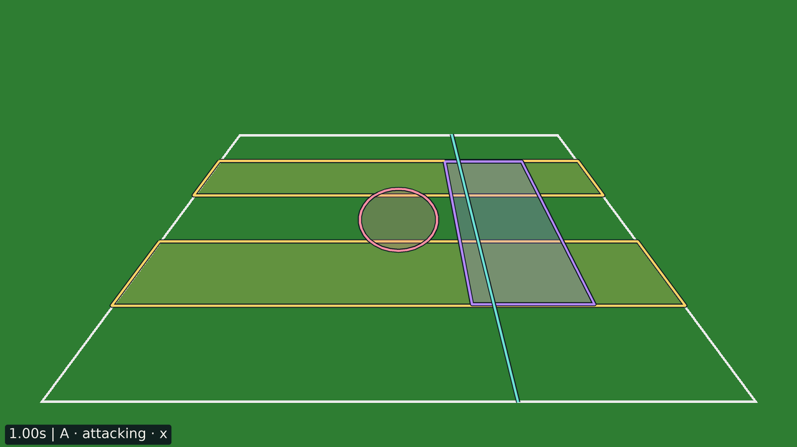
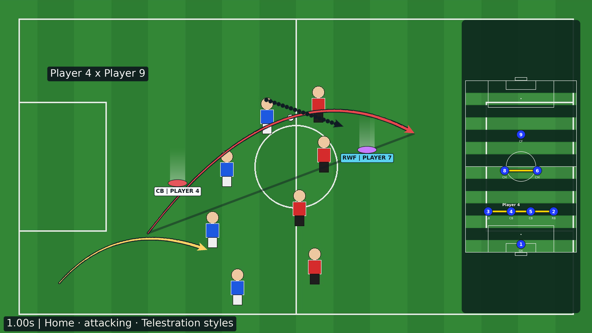
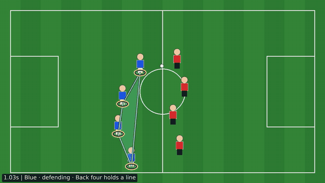
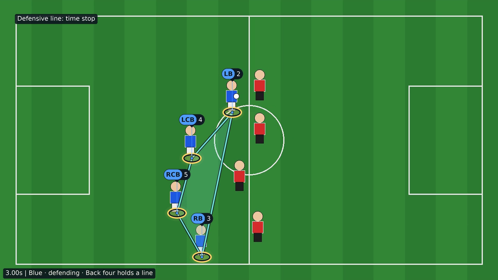
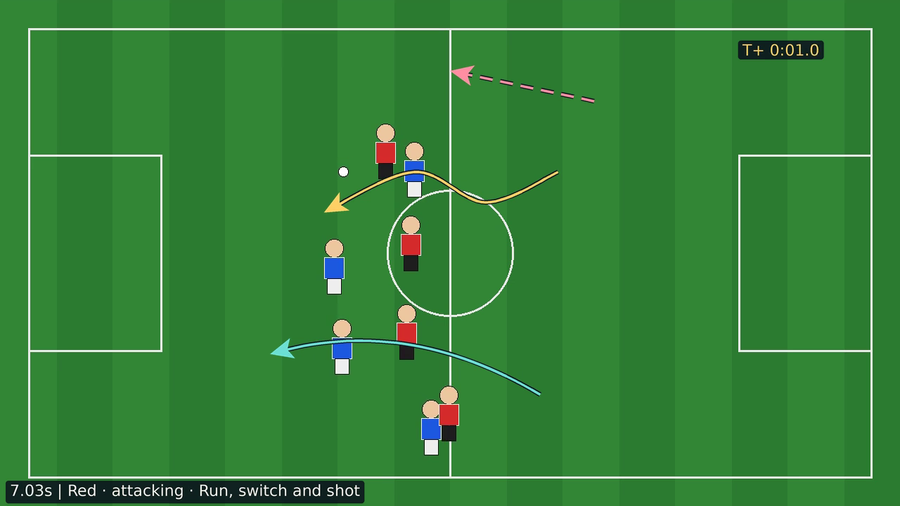
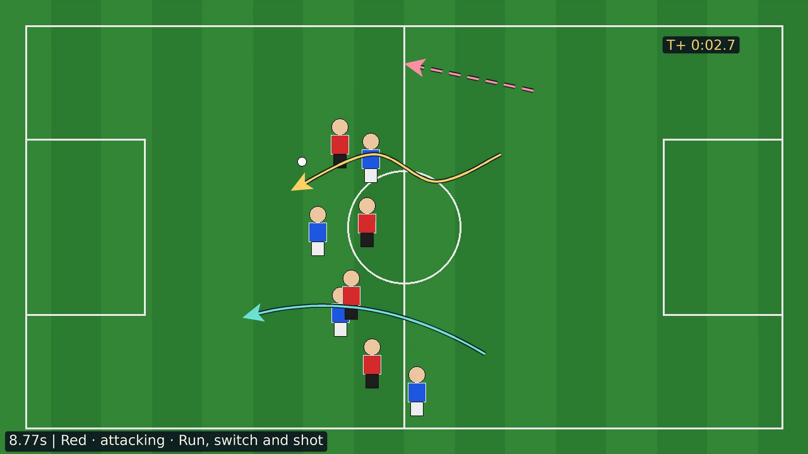
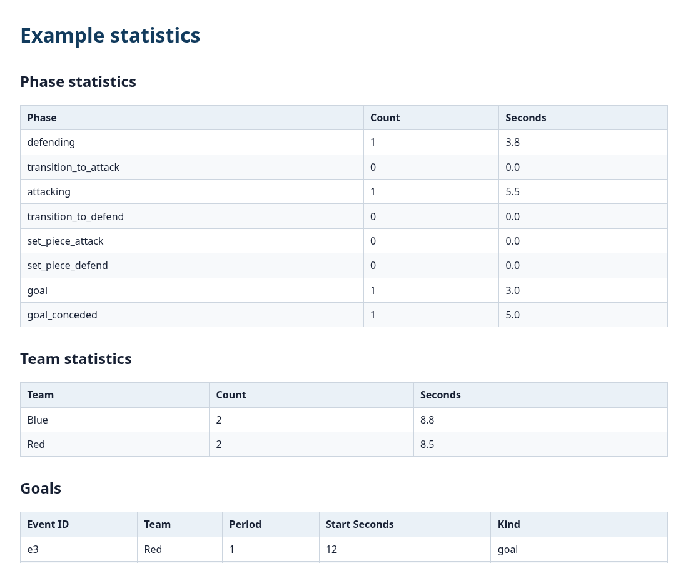

<a id="readme-top"></a>

<div align="center">
  <h3 align="center">Once Sport MCP</h3>
  <p align="center">
    Local MCP server and CLI for reviewed football video analysis<br/>
    Powered by Python, FFmpeg, OpenCV &amp; Pillow
  </p>
</div>

<div align="center">
<br/>


</div>

---

<details>
  <summary>Table of Contents</summary>
  <ol>
    <li><a href="#section-about">About</a></li>
    <li><a href="#section-status">Status</a></li>
    <li><a href="#section-install">Install</a></li>
    <li><a href="#section-config">Configuration</a></li>
    <li><a href="#section-usage">Usage</a></li>
    <li><a href="#section-features">Features</a></li>
    <li><a href="#section-examples">Examples</a></li>
    <li><a href="#section-development">Development</a></li>
  </ol>
</details>

---

## About
<a id="section-about"></a>

Turns a host agent's analysis of a football video into reviewed, reproducible output. The agent proposes timed events and drawings, an operator approves the exact digest, and a worker renders it. Everything runs locally over MCP stdio or a CLI, with no editor or desktop automation.

- Tag events (defending, transitions, attacking, set pieces, goals) and export a Once-compatible CSV.
- Ingest local or permitted YouTube video, with persistent jobs, cancel/retry and hash-verified artifacts.
- Render reels with drawings, tracking, formations, time stop and slow motion; export statistics.
- Optionally export through a locally installed Once Sport executable.

<div align="right"><a href="#readme-top">↖ Back to top</a></div>

---

## Status
<a id="section-status"></a>

**Pre-release (`0.1.0a8`).** Interfaces may change. Tested on Linux with Python 3.13 and FFmpeg only.

- Native Once export rejects holds, speed segments, text, flags and the newer drawing kinds; use the custom renderer for them.
- Tracking is seeded by the host, one target per job. There is no re-identification, occlusion recovery or automatic player detection.
- Not implemented: magnifier, player vision, chroma key, image import, field mapping.
- Untested: opening native output in the Once GUI, Windows and macOS.
- Rendering 1080p costs roughly 0.1-0.25 s per output frame; keep clips short.
- The reviewer name is an operator assertion, not authentication.

<div align="right"><a href="#readme-top">↖ Back to top</a></div>

---

## Install
<a id="section-install"></a>

Requires Python 3.11+, [uv](https://docs.astral.sh/uv/), and `ffmpeg`/`ffprobe` on `PATH` (plus `yt-dlp` for YouTube sources).

From the repository root:

```bash
uv sync                     # core
uv sync --extra tracking    # adds OpenCV for tracking
uv run once-sport-mcp       # starts the MCP stdio server
```

<div align="right"><a href="#readme-top">↖ Back to top</a></div>

---

## Configuration
<a id="section-config"></a>

Read at server start. With none set, only four timeline tools are registered.

| Variable | Meaning |
|---|---|
| `ONCE_SPORT_OUTPUT_DIR` | Where CSV files are written (default `.data/output`). |
| `ONCE_SPORT_WORKSPACE` | Absolute dedicated directory. Setting it enables the workflow tools. |
| `ONCE_SPORT_ALLOWED_SOURCE_DIRS` | JSON array of permitted source directories (default `<workspace>/inputs`). |
| `ONCE_SPORT_TRACKING_ENABLED` | `1` enables tracking tools (needs the `tracking` extra). |
| `ONCE_SPORT_NATIVE_EXECUTABLE` | Absolute path to the Once executable; enables native export. |

MCP client entry (replace the placeholders):

```json
{
  "mcpServers": {
    "once-sport": {
      "command": "/absolute/path/to/once-sport-mcp/.venv/bin/once-sport-mcp",
      "env": {
        "ONCE_SPORT_WORKSPACE": "/absolute/path/to/workspace",
        "ONCE_SPORT_ALLOWED_SOURCE_DIRS": "[\"/absolute/path/to/videos\"]",
        "ONCE_SPORT_TRACKING_ENABLED": "1"
      }
    }
  }
}
```

<div align="right"><a href="#readme-top">↖ Back to top</a></div>

---

## Usage
<a id="section-usage"></a>

**Timeline tools** (always available): `validate_timeline`, `generate_once_import_csv`, `search_events`, `summarize_phases`. An event has `event_id`, `period` (1-4), `start_seconds`, `end_seconds`, `team`, `phase`, `action`, and optional `players`, `notes`, `flag` (`good`/`bad`/`favourite`) and `playlists`. Phases: `defending`, `transition_to_attack`, `attacking`, `transition_to_defend`, `set_piece_attack`, `set_piece_defend`, `goal`, `goal_conceded`. See `examples/timeline.synthetic.json`.

**Workflow** (needs a workspace). Jobs run in a separate worker process:

```bash
uv run python -m once_sport_mcp.worker --root /absolute/path/to/workspace \
  --allow-source-dir /absolute/path/to/videos --enable-tracking
```

Flow: `create_analysis_project` → `request_analysis_evidence` (frames) → `submit_analysis_proposal` → operator `review_analysis_proposal` with the exact digest → `request_analysis_export` (reel) or `request_analysis_statistics`, then `list_analysis_artifacts` / `get_analysis_artifact`. Exports before approval, or with a stale digest, are refused.

The same flow is available from the CLI: `uv run once-sport-workflow --help`.

<div align="right"><a href="#readme-top">↖ Back to top</a></div>

---

## Features
<a id="section-features"></a>

Drawing kinds (custom renderer): `ellipse`, `arrow`, `line`, `polygon`, `label`, `polyline`, `curve`, `area`, `spotlight`, `stopwatch`, `nametag`, and `speed` (slow motion 0.25/0.5x or fast forward 2/4x; audio is tempo-stretched and peak-limited inside). Arrows have tangent-aligned notched heads; `polyline` takes `smooth` (spline through the points) and `line`/`arrow`/`polyline`/`curve` take `dash`. `nametag` shows a position badge (`GK`, `LB`, `LCB`, `CM`, `AMF`, `CF`, `RW`, ...) and an optional name (max 24 chars) above a player. Drawings accept `keyframes` for movement (with optional `easing`: `linear` or `ease_in_out`), optional `fade_in_seconds`/`fade_out_seconds`, and `hold_seconds` pauses the clip on a drawing (time stop, silent during the freeze).

- **Tracking:** `request_analysis_tracking` follows one seeded target with OpenCV CSRT and flags loss for review.
- **Pitch templates:** `build_pitch_drawings` (CLI `pitch`) projects a circle, rectangle, half-spaces, five channels, zone 14, a zone grid, a cover shadow or an offside line through a 4-point pitch calibration (metres on a 105x68 pitch to normalized frame points), so shapes follow the pitch perspective. The calibration is fixed: use it for a static camera or a short shot. Pitch templates are projected with a fixed calibration, so combine them with `stabilize` for a moving camera.

  
- **Analyst-style telestration:** `player_marker` (a filled ellipse at the feet, a faint light column over the player and a `POSITION | NAME` tag below, with optional `tag_color` and `size`), `lob` (a lofted pass: a tapered arc plus a dark ground shadow, `arc` sets the height), `dash: "dotted"` for movement and marking arrows, `taper: true` for arrows and curves, and `board`, a top-down tactical board inset with numbered tokens, names, position codes and link lines (`players` in metres on a 105x68 pitch, `links` as player indexes, the panel is the rectangle between the two points). `start_gap` and `end_gap` (fractions of the frame height, 0-0.1) on `line`, `arrow`, `polyline`, `curve` and `lob` stop the path short of the player at either end, so an arrow starts and ends next to the players instead of on top of them. `build_formation_drawings` tags accept `"style": "marker"` (CLI `--tag POSITION:NAME:marker`). Position codes include `RWF`, `LWF`, `CMF`, `DMF`. Custom renderer only.

  

- **Stay on the pitch:** `stabilize: true` makes a static drawing follow the camera: motion is estimated from the pitch texture and lines (OpenCV) and turned into keyframes. It stops at scene cuts or when a point leaves the frame and says so in the manifest (`stabilize`), instead of drifting. `ground: true` keeps `area`, `line`, `arrow`, `polyline`, `curve`, `polygon`, `ellipse` and `spotlight` drawings off the players: they are only painted on grass and pitch lines (colour-based mask, so dark-green kits and night games can fool it; frames with little grass skip masking). Both are custom-renderer only.
- **Holds and trails:** up to 5 `hold_seconds` freezes per event (at most 30 s in total) for step-by-step explanations, and a `trail` drawing (one point + keyframes, `trail_seconds` 0.3-10) for the recent path of a runner. `build_formation_drawings` takes `trails` (CLI `--trails`) to add one per tracked player.
- **Voice-over:** `python -m once_sport_mcp.voiceover REEL NARRATION OUT [--offset S] [--duck-db 12]` mixes a narration file into a finished reel and lowers the match audio while it plays. The video stream is copied, nothing is overwritten.
- **Animation:** drawings accept `fade_in_seconds`, `fade_out_seconds` and keyframe `easing` (`linear` or `ease_in_out`). Drawings are painted in a fixed order (areas under lines, then spotlights, nametags, labels).
- **Statistics:** HTML and XLSX carry the same tables (phase, team, action, period, flags, playlists, players by phase and flag, goals, scoreline), interval-union coverage next to summed clip seconds, SVG charts, and `MM:SS` match clock when events give `clock_offset_seconds` per period.
- **Formations:** `build_formation_drawings` composes 2-11 tracked targets into lines, rings or spotlights, an area, and optional nametags (`tags`, CLI `--tag POSITION[:NAME]`). It stops before targets might overlap and never submits anything itself.
- **Statistics:** XLSX, HTML and JSON counts by phase, team, action, period, goals, players, flags and playlists. No video needed.
- **Playlists:** `request_analysis_export(playlist="NAME")` renders only the events in that playlist.
- **Native export:** `request_native_analysis_export` uses the installed Once executable for the supported subset and fails closed otherwise.

<div align="right"><a href="#readme-top">↖ Back to top</a></div>

---

## Examples
<a id="section-examples"></a>

Everything below comes from a synthetic pitch video generated by this repository (no match footage). Reproduce it with `examples/demo/make_synthetic_pitch.py` and `examples/demo/run_demo.py`.

<p align="center">
  
</p>

| Formation + time stop | Drawing kinds |
|---|---|
|  |  |
| Four players tracked from one seed each, with position nametags, joined by lines and a shaded area; the clip pauses for 2 s on the label (`hold_seconds`). | A smooth `polyline` arrow, a dashed arrow, a `curve` and a `stopwatch` on a second event. |
|  |  |
| `speed: 0.5` slows the segment; the crowd audio is stretched and its peaks limited. | Statistics export (XLSX/HTML/JSON) from the approved events. |

Each frame carries a caption with time, team, phase and action. If a tracked player is lost, the formation stops early and reports `needs_reseed` (the demo's last 0.7 s shows this).

<div align="right"><a href="#readme-top">↖ Back to top</a></div>

---

## Development
<a id="section-development"></a>

```bash
uv run --frozen --extra tracking pytest -q
uv run --frozen --extra tracking ruff check .
uv run --frozen --extra tracking ruff format --check .
```

The workflow state lives only in your workspace directory; Once Sport's own project database is never read or modified. Timeline inputs are not deliberately logged, but your MCP client may retain them. Avoid sensitive data.

Released under the [MIT License](LICENSE).

<div align="right"><a href="#readme-top">↖ Back to top</a></div>
